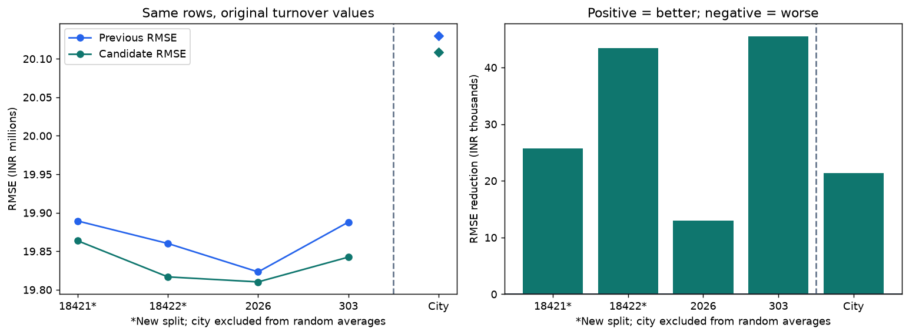

# Restaurant turnover — October 18 improvement report

**Student register number:** submission  
**Student name:** submission  
**Team name:** submission

## Decision

**Candidate recommended for a new portal trial.** The workspace root CSV and notebook now contain this tested v5 candidate. The portal-confirmed v3 remains in confirmed_best_backup.

The new CSV is a model-generated candidate, not a confirmed first-place submission.
No upload was performed. Only the portal can measure its hidden-test RMSE.

## What changed on the leaderboard

Source: your October18, 12:42PM screenshots; this is not a live leaderboard query.

| Entry | Rank in screenshot | Portal RMSE |
|---|---:|---:|
| submission — your previous submitted model | 18 | 12,094,600.3216516 |
| submission — leader | 1 | 11,917,847.2693885 |
| New v5 candidate | Unknown | Not submitted |

Your score did not worsen; competitors moved ahead. There are still two recorded
submissions. Beating the shown leader requires a reduction greater than
**176,753.05 (1.4614%)**, provided that leading score remains unchanged.

## Model and experiment design

Screened **22 settings**, each with five-fold validation and two model seeds.
Six settings advanced to a second development assignment. Compared 24 coarse
blend combinations, then froze the selected settings before confirmation.

- **25.0% previous v3 ensemble**.
- **25.0% sqrt_d6_correct1**: `{"correct_mean": true, "depth": 6, "power": 0.5}`.
- **25.0% subspace_h40**: `{"iterations": 1200, "loss": "Huber:delta=40", "rsm": 0.5}`.
- **25.0% quantile0.6**: `{"depth": 5, "loss": "Quantile:alpha=0.6"}`.
- Each new component averages two CatBoost model seeds, 10242 and 20242.
- No hidden test labels, external target matching, or adjustments fitted to portal scores.
- Training-only target transformations, caps and feature selection were compared.
  Every validation score uses all original turnover labels in INR. Encoders and
  imputers are fitted only on the corresponding training fold.

Full configuration: [candidate_lock.json](../improvement_v5/results/candidate_lock.json).
All development comparisons: [selection.csv](../improvement_v5/results/selection.csv).

## Same-fold validation results

| Validation | Previous v3 RMSE | New v5 RMSE | Reduction (positive is better) |
|---|---:|---:|---:|
| 18421 | 19,889,372.50 | 19,863,662.63 | +25,709.87 |
| 18422 | 19,860,129.68 | 19,816,733.50 | +43,396.18 |
| 2026 | 19,823,207.78 | 19,810,210.84 | +12,996.93 |
| 303 | 19,887,896.10 | 19,842,435.76 | +45,460.34 |
| city | 20,129,673.34 | 20,108,310.64 | +21,362.69 |

| Shuffled-validation summary | Previous | Candidate | Reduction |
|---|---:|---:|---:|
| Mean of four assignments | 19,865,151.51 | 19,833,260.68 | +31,890.83 |
| Mean of two new assignments | 19,874,751.09 | 19,840,198.07 | +34,553.02 |

18421 and 18422 are new split assignments. 2026 and 303 were used in earlier
rounds; city groups form a separate stress check and are excluded from the random
split average. All assignments reuse previously examined labels, so they are
robustness checks rather than an untouched final test. Known city aliases are
grouped, but unrecognized spelling variants may remain.

Conditional row-bootstrap 95% interval for the RMSE reduction:
**[3,832.21, 56,418.51]**.
It excludes zero conditional on these fitted fold predictions.
The interval does not include the uncertainty from all model selection or a
different test distribution. Local validation RMSE must not be subtracted from
the portal score to predict ranking.

## Execution and tests

- 9 notebook code cells executed, with saved outputs and 2 figures; no saved errors.
- Actual hash-verified fold predictions reused explicitly in the local executed notebook; metrics recomputed.
- The notebook's default uncached implementation retrained all five folds of assignment18421 and reproduced the reference predictions within INR0.01.
- Full selected models freshly fitted in both the independent pipeline and notebook; matching predictions.
- The predecessor refit reproduces the portal-confirmed v3 CSV within INR0.01.
- Predictions remain aligned when test rows are permuted. Missing values and an unseen city were checked.
- Independent and pipeline validators rejected 12 malformed CSV cases: missing/extra row, row order, headers/order, index column, student ID replacement, duplicate IDs, NaN, both infinities and negative turnover.
- Exactly **500 rows, two columns, 501 CSV records including header**, original test IDs/order, finite positive turnover, no extra index.
- Submission range: **11,554,282.57–59,912,040.45**; mean absolute change from v3: **806,498.64**.

Details: [submission_checks.json](../improvement_v5/results/submission_checks.json),
[uncached_notebook_check.json](../improvement_v5/results/uncached_notebook_check.json).

## Files and use

1. [New candidate CSV](../improvement_v5/submission.csv) — `submission.csv`.
2. [Matching executed Colab notebook](../improvement_v5/submission.ipynb) — `submission.ipynb`.
3. [Portal-confirmed v3 backup](../improvement_v5/confirmed_best_backup/submission.csv).

To reproduce in Colab, upload the notebook and run all cells on CPU. Upload
Train_dataset.csv, Test_dataset.csv, Sample_Solution.csv and Data_Dictionary.csv
when prompted. Colab trains validation folds by default; the final cell downloads
the CSV. The original source data is not embedded in the notebook.

If trying the candidate, upload the CSV under the hackathon. Save the returned
RMSE alongside this version. The row-level Registration Number column contains
the restaurant IDs, not your student register number. Submit the executed notebook
matching your final choice to LLJ_Oct_2026 when ready; the supplied instructions
allow one final notebook submission.

CSV SHA256: `66a673efc5f31bc9f4010de033999fd3712444b8f6dd0478c97e77bb3934630d`  
Notebook SHA256: `46b7366227f295844988b8512d012ecfa141aa7b81b42df42f565082e4880f48`
